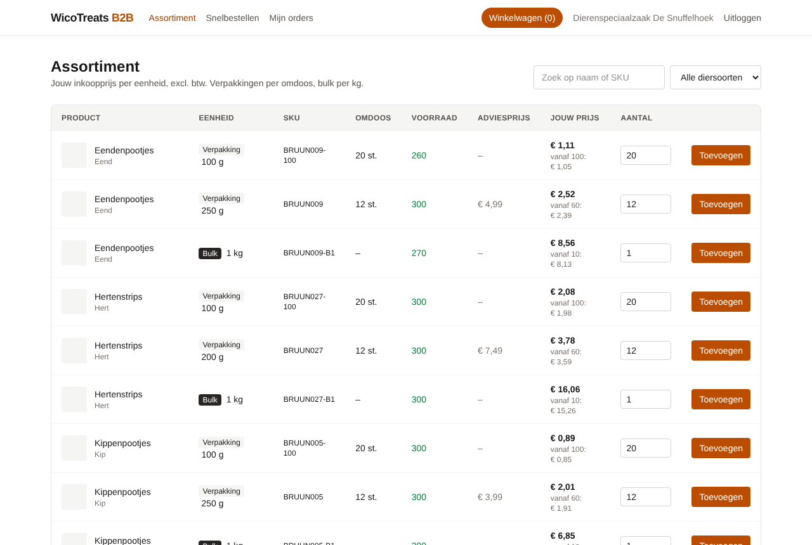
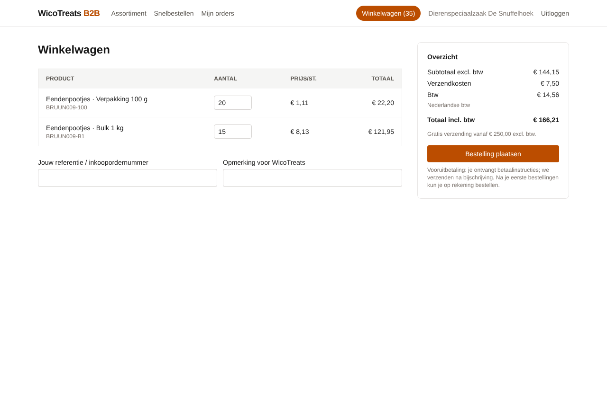
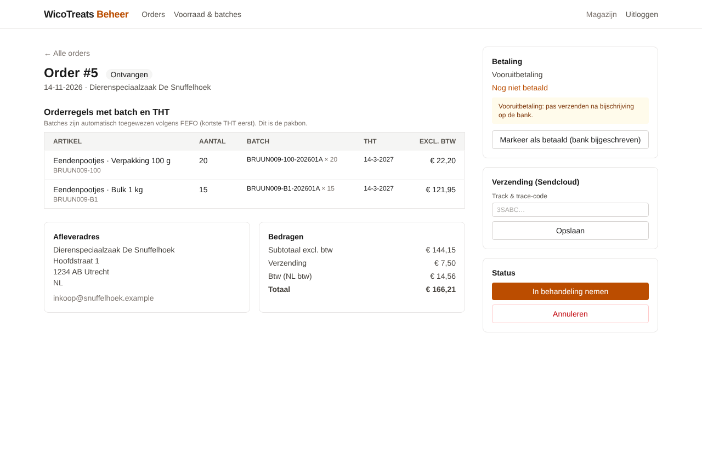
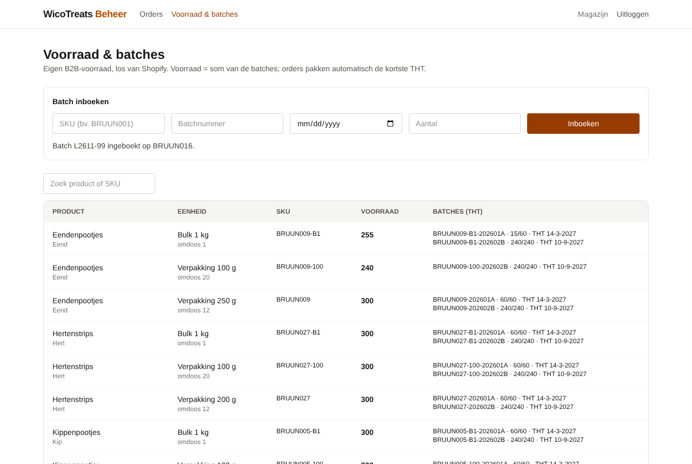

# WicoTreats B2B-webshop

Standalone bestelportaal (website + API) voor wederverkopers van WicoTreats / BRUUN hondensnacks.
Plan van aanpak, scope en architectuur: [docs/PLAN.md](docs/PLAN.md).

```
apps/api   Fastify + Prisma + PostgreSQL  → REST-API (login, catalogus met klantprijzen, btw-regime, orders, batches/THT, beheer)
apps/web   Next.js + Tailwind             → dealerportaal (assortiment, snelbestellen, winkelwagen, orders)
                                           + beheer voor medewerkers (orders met batch/THT, betaling, voorraad, klanten)
docs/      plan met beslissingen, screenshots
```

## Lokaal draaien

Vereist: Node 22, pnpm, en PostgreSQL (via Docker of lokaal).

```bash
pnpm install
pnpm db:up                                   # start Postgres via Docker (of gebruik een eigen database)
cp apps/api/.env.example apps/api/.env       # DATABASE_URL, JWT_SECRET aanpassen
cp apps/web/.env.local.example apps/web/.env.local
pnpm db:migrate                              # maakt tabellen aan
pnpm db:seed                                 # testdata: prijslijsten, demo-dealer, 7 producten
pnpm dev                                     # API op :4000, web op :3000
```

Testlogins na de seed:

| Rol | E-mail | Wachtwoord | Ziet |
|---|---|---|---|
| Dealer (NL, 9% btw, eerste 2 orders vooruit) | dealer@snuffelhoek.example | dealer1234 | shop |
| Dealer (BE, btw verlegd, op rekening) | dealer@hondenwinkel.example | dealer1234 | shop |
| Medewerker (STAFF) | magazijn@wicotreats.com | staff1234 | orders, voorraad & batches |
| Beheer (ADMIN) | admin@wicotreats.com | admin1234 | alles, incl. klanten en prijzen |

## Hoe het werkt (kort)

- **Prijzen** alleen na inloggen, excl. btw. Bij afrekenen: NL → 9% btw; EU met gecontroleerd btw-nummer → btw verlegd; buiten EU → 0%.
- **Eenheden** per product: verpakking (bv. 250 g, 100 g, 5 st) en bulk (bv. 1 kg), elk met eigen SKU, prijs en voorraad.
- **Betaling**: eerste twee orders vooruitbetalen, daarna op rekening (14 dagen). Medewerker markeert "betaald" bij bankbijschrift; vooruitbetaalde orders kunnen pas daarna op verzonden.
- **Voorraad** is eigen B2B-voorraad, opgebouwd uit batches met THT. Een order koppelt automatisch batches volgens FEFO (kortste THT eerst); de pakbon toont batch + THT per regel.
- **Verzending** via Sendcloud: nu trackingcode per order, API-koppeling volgt.

## Producten uit Shopify halen

Maak in Shopify-admin een *custom app* aan met de scopes `read_products` en `read_inventory`,
zet `SHOPIFY_STORE_DOMAIN` en `SHOPIFY_ADMIN_TOKEN` in `apps/api/.env` en draai:

```bash
pnpm --filter @wicotreats/api shopify:sync
```

Alle actieve producten, SKU's, adviesprijzen en EAN's komen dan in de B2B-database (voorraad niet: B2B heeft eigen batches).
B2B-prijzen zet je daarna via de admin-API (`PUT /admin/price-lists/:id/items`), extra eenheden via `POST /admin/products/:id/variants`.

## API in het kort

| Methode & pad | Wie | Doel |
|---|---|---|
| `POST /auth/login`, `/auth/logout`, `GET /auth/me` | iedereen | sessie (JWT in httpOnly-cookie) |
| `POST /auth/register` | iedereen | dealeraanvraag (bedrijf komt op `PENDING`) |
| `GET /catalog/products?animal=&search=` | dealer | assortiment met klantprijs en staffels |
| `POST /catalog/lookup` | dealer | SKU's opzoeken voor snelbestellen |
| `POST /orders/quote`, `POST /orders`, `GET /orders` | dealer | prijsberekening, order plaatsen, historie |
| `GET /admin/dashboard`, `GET/PATCH /admin/orders(/:id)` | medewerker | inkomende orders, status, betaald, trackingcode |
| `GET /admin/stock`, `POST/PATCH /admin/batches`, `GET /admin/batches/:id/orders` | medewerker | voorraad, batch inboeken, traceerbaarheid |
| `GET/PATCH /admin/companies`, `POST /admin/companies/:id/check-vat` | beheer | dealers goedkeuren, VIES-check, betaalafspraken |
| `GET/POST/PUT /admin/price-lists`, `POST /admin/products/:id/variants`, `PATCH /admin/variants/:id` | beheer | prijzen en B2B-eenheden |
| `GET/PUT /admin/settings`, `POST /admin/users` | beheer | minimale order, franco, bankgegevens; medewerker-accounts |

## Screenshots





